# ONMYLIB // Library Management System

一个用 C 语言从零实现的图书管理系统，不依赖第三方容器库：
自研泛型 `Vector` / `String` / `Pair` / `List` / `Hash` / `Trie`，
基于本地文件 + 哈希索引的存储层，并提供命令行与 ncursesw 终端两套界面。

主要作者：[Leabol](https://github.com/Leabol)、LingNc

---

## **项目结构**

```
project-root/
├── include
│   ├── DataBase/    DataBase.h  Index.h          文件数据库 + 哈希索引
│   ├── models/      Book  Student  Manager       数据模型
│   ├── Tools/       Vector  String  Pair  List
│   │                Type  Hash  Trie             自研泛型容器与工具
│   ├── service/     auth  admin  borrow
│   │                import  search  format       业务逻辑（无 UI 依赖）
│   ├── ui/                                       命令行界面
│   │   ├── components/  menu  page  list  func  passwd
│   │   ├── admin/       管理员各页面
│   │   ├── student/     学生各页面
│   │   └── tui/       ncursesw 终端界面
│   │       ├── key  width  theme  window         核心（键位/宽度/配色/帧）
│   │       ├── components/  menu  table  form  dialog  prompt
│   │       └── views/       主菜单、登录、管理员、学生、命令面板
│   ├── function.h
│   └── uiBook.h  uiStudent.h
├── src/             与 include 对应的 .c 实现
├── test/            单元测试
├── docs/            设计与实现文档
├── Book.txt         图书导入样例
├── Student.txt      学生导入样例
├── Makefile
└── README.md
```

## 运行环境

### 1.**Linux**（Ubuntu24.04）

### 2.ncursesw（TUI 使用的宽字符库）

```sh
sudo apt install libncursesw5-dev   # Debian / Ubuntu
```

### 3.gcc

#### 4.第三方库（check.h，仅 test_check 需要）

---

## 构建与运行

```sh
make              # 默认同时构建命令行界面与 TUI（需要 ncursesw）
make UI=cli       # 只构建命令行界面，不依赖 ncursesw

./main            # 命令行界面（原有行为）
./main --tui      # 终端图形界面
```

TUI 需要 UTF-8 locale 与支持宽字符的终端；非交互终端或 locale 不合适时会自动回退到命令行界面。

常用测试目标：

```sh
make test-tui          # 宽字符宽度逻辑
make test-borrow       # 借还业务规则
make test-search       # 关键字搜索
make test-find         # 数据库条件查询
make test-import-files # 导入文件格式
```

### TUI 按键

| 按键 | 作用 |
|---|---|
| `↑`/`↓`、`j`/`k` | 移动 |
| `←`/`→`、`h`/`l`、`PgUp`/`PgDn` | 翻页 |
| `Enter` | 确认 / 打开 |
| `q`、`Esc` | 返回 / 取消 |
| `1`–`9` | 直接选择对应项 |
| `/` | 命令面板 |
| `Tab` | 命令补全 / 表单切换字段 |

命令面板：`/search <关键字>` 搜索图书，`/students <关键字>` 搜索学生，
`/set <n>` 固定每页行数、`/set auto` 恢复自适应，`/page <n>` 跳转页码，`/help` 查看帮助。

### 表格分页

表格默认**自动填满窗口高度**（表头 1 行 + 分隔线 1 行 + 底部信息 1 行，其余全为数据行），
窗口缩放后自动重算页大小。用 `/set <n>` 可固定行数，`/set auto` 恢复自适应。

### 批量导入文件格式

```text
Book.txt     每行 5 列：ISBN,书名,作者,出版社,出版时间
Student.txt  每行 4 列：学号,姓名,班级,学院
```

数据库记录 ID、图书借阅状态与时间、学生借阅数量及索引均由系统维护，不从文件导入。
导入会先完整校验（列数、字段长度、学号合法性与唯一性），通过后才写入。

---

## **模块划分**

### 1. **主程序模块**
- **文件**: `main.c`
- **职责**: 程序入口，负责初始化系统、处理用户输入和调用其他模块的功能。

### 2. **数据模型模块（POJO层）**
- **文件**:
  - `book.h` 和 `book.c`
  - `student.h` 和 `student.c`
- **职责**: 定义数据结构和操作数据的函数。

### 3. **数据库模块（DAO层）**
- **文件**: `database.h` 和 `database.c`

- **职责**: 提供与文件或数据库交互的函数，负责数据的持久化。

```
├── DataBase
│   ├── DataBase.h
│   └── Index.h
```


```
├── DataBase.c
```


### 4. **工具模块（tools层）**
- **文件**: `tools.h` 和 `tools.c`
- **职责**: 提供通用的工具函数，如字符串处理、时间处理等。

```
├── Tools
│   ├── List.h
│   ├── Pair.h
│   ├── String.h
│   ├── Type.h
│   └── Vector.h
```


```
├── Tools
│   ├── List.c
│   ├── Pair.c
│   ├── String.c
│   ├── Type.c
│   └── Vector.c
```

### 5. **业务逻辑模块（service 层）**
- **目录**: `src/service`、`include/service`
- **职责**: 封装认证、图书/学生/管理员管理、借还、搜索、批量导入等业务规则。
  不包含任何终端输出与键盘输入，命令行界面与 TUI 共用这一层。

### 6. **界面模块（UI 层）**
- **目录**: `src/ui`、`include/ui`
- **职责**: 两套可共存的界面实现。
  - `ui/`：命令行界面（`printf` + 逐键读取）
  - `ui/tui/`：基于 ncursesw 的终端图形界面，含键位抽象、宽字符排版、
    配色主题、菜单/表格/表单/对话框/命令输入框等组件

### 7. **数据文件**
- **目录**: `db`（运行时自动创建）
- **职责**: 存储持久化数据（`.db` 数据文件与 `.idx` 索引文件）。

### 8. **测试模块**
- **目录**: `test`
- **职责**: 包含单元测试代码与导入文件格式检查脚本。

### 9. **构建工具**
- **文件**: `Makefile`
- **职责**: 定义编译规则，简化构建过程；支持 `UI=both|cli|tui` 选择界面后端。


---

## **功能实现**

### 1. **主程序模块**
- **文件**: `main.c`
- **功能**:
  - 初始化系统。
  - 显示菜单并处理用户输入。
  - 调用其他模块的功能。

### 2. **数据模型模块**

#### 2.1 书籍管理
- **文件**: `book.h` 和 `book.c`
- **功能**:
  - 定义`Book`结构体。
  - 实现书籍的增删改查功能。
  
  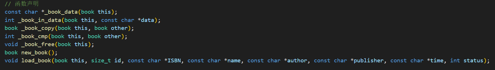

#### 2.2 学生管理
- **文件**: `student.h` 和 `student.c`
- **功能**:
  - 定义`Student`结构体。
  - 实现学生的增删改查功能。
  
  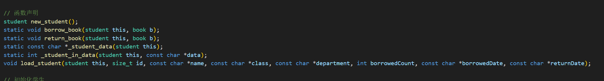

### 3. **数据库模块**
- **文件**: `database.h` 和 `database.c`
- **功能**:
  - 提供文件读写接口。
  - 实现数据的持久化。

### 4. **工具模块**
- **文件**: `include/Tools`、`src/Tools`
- **功能**:
  - 用C语言实现了C++中vector， string与 list的绝大部分功能与实现 **键->值**pair的基本功能。
  - 额外实现了 SHA-256 哈希（`Hash`）与命令补全用的前缀树（`Trie`）。
  - 实现代码的**封装，泛型**

#### vector功能

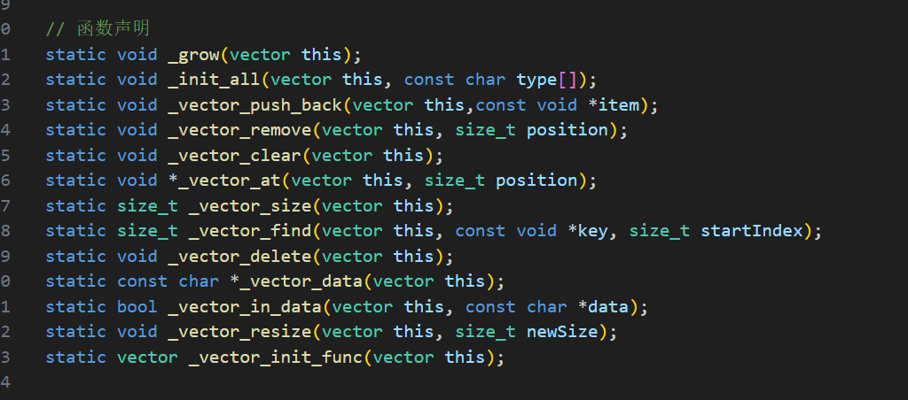

#### string功能

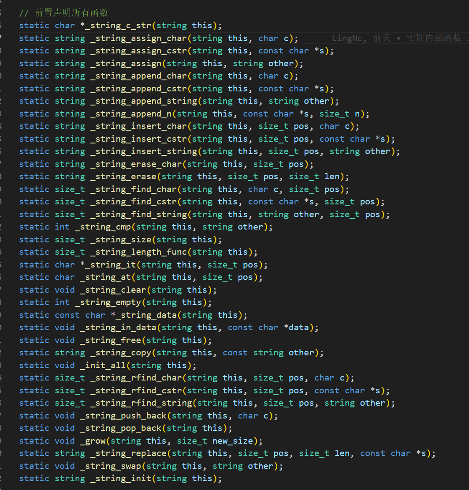

#### list功能

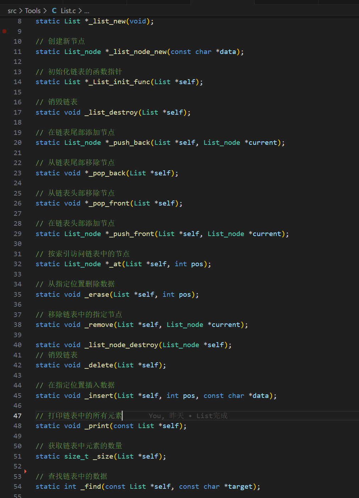

#### pair功能

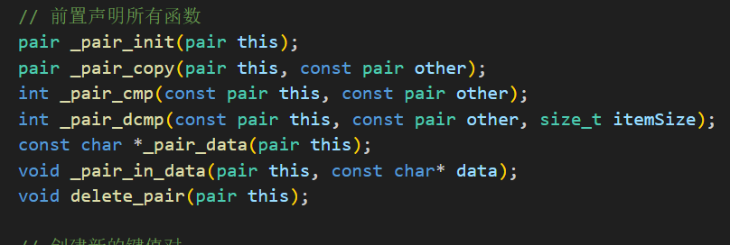


### 5. **命令行界面（UI）**

- **文件**: `src/ui`、`include/ui`
- **功能**:
  - 实现菜单显示和用户输入处理。
  - 菜单、分页列表、密码输入、命令自动补全等交互组件。

#### 终端图形界面（TUI）

`src/ui/tui/` 另提供基于 ncursesw 的终端界面，用 `./main --tui` 启动：

- 灰阶冷调主题，中文按显示列宽对齐
- 菜单 / 分页表格 / 表单 / 对话框 / 命令输入框组件
- 支持每页行数自适应窗口、`/` 命令面板

#### 开始页面

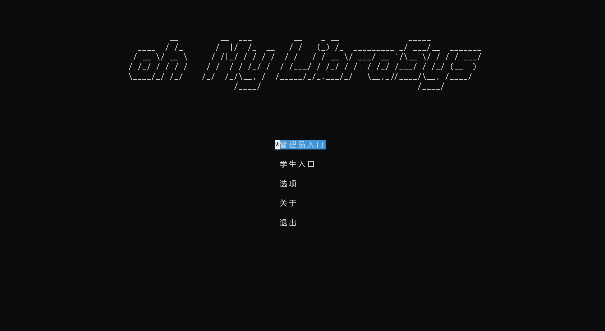

#### 一个图书馆管理系统的界面，显示了库存总数、可借阅书籍数量、管理员信息和时间。列表中包含了书籍的ISBN、书名、作者、出版社和借阅状态。用户可以选择添加图书、批量导入、查询图书或退出系统。

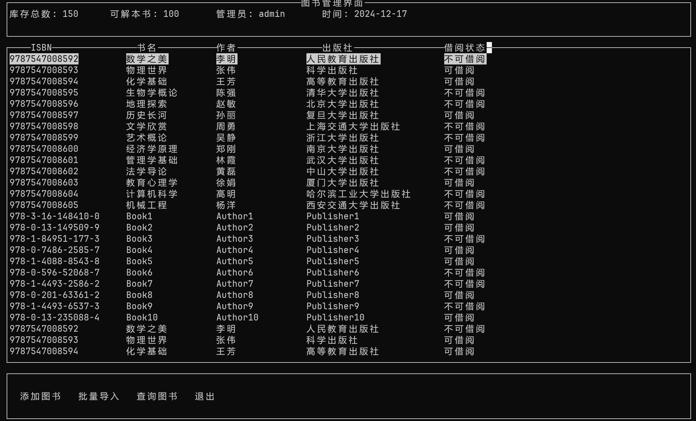

#### 显示了图书馆系统中某一本书的详细信息，包括ISBN、书名、作者、出版社和借阅状态。用户可以选择对这本书进行修改、删除或取消操作。

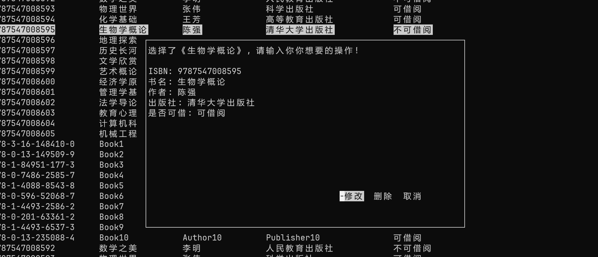

##### 显示了图书馆系统中的书籍列表，用户可以输入ISBN号来查询书籍的详细信息。每本书的信息包括ISBN、书名、作者、出版社和借阅状态。

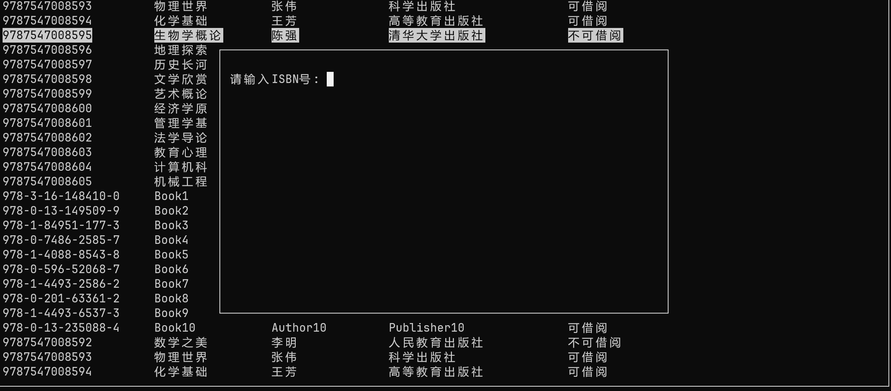

#### 显示了图书馆管理系统的界面，包含库存总数、可借阅书籍数量、管理员信息和时间。列表中包含了书籍的ISBN、书名、作者、出版社和借阅状态。用户可以选择添加图书、批量导入、查询图书或退出系统。

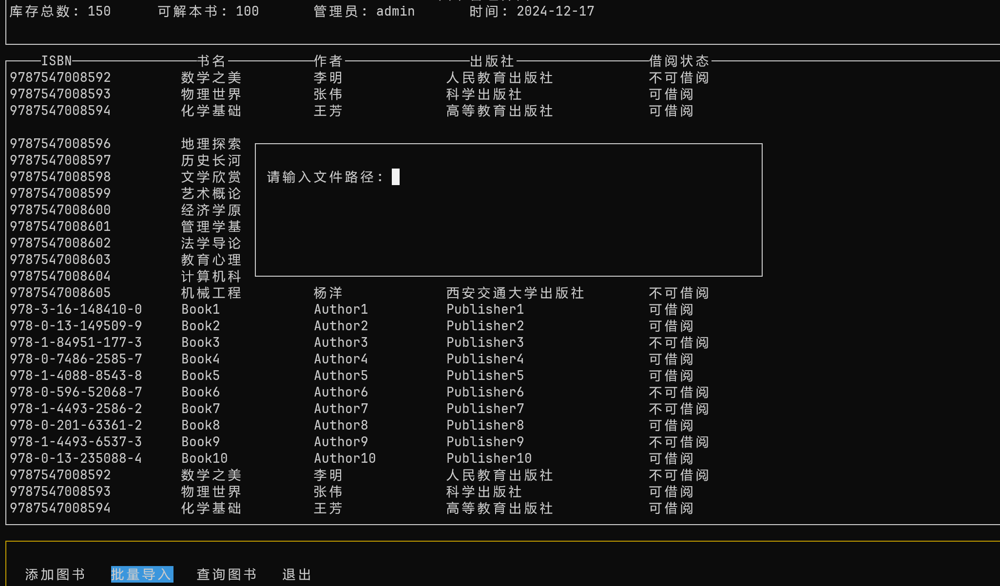

#### 显示了学生的学号、姓名、班级、学院和借阅数量。用户可以选择添加学生、批量导入、查询学生或退出系统。

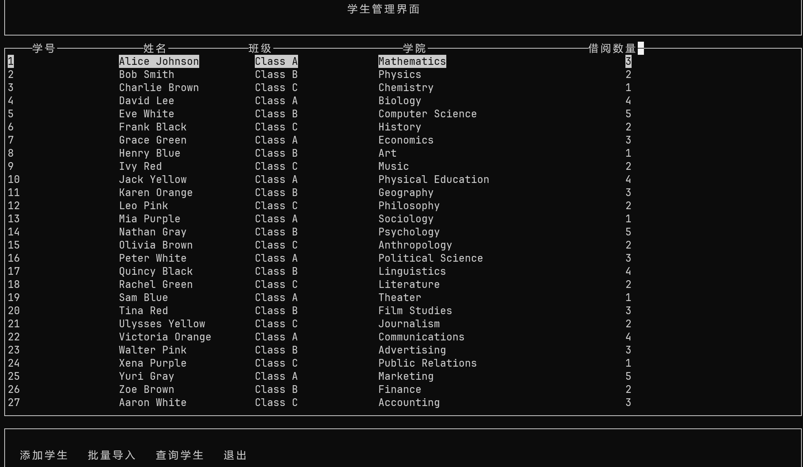

---

## **测试计划**

### 1. **单元测试**
- **文件**: `test/` 目录
- **内容**:
  - `test_string.c` / `test_vector.c`：字符串与向量容器
  - `test_tui_width.c`：宽字符宽度计算与截断
  - `test_borrow_service.c`：借书、还书、逆期、借阅上限
  - `test_search_service.c`：图书与学生关键字搜索
  - `test_database_find.c`：数据库条件查询
  - `test_import_files.sh`：导入文件格式与唯一性检查

> 注：`make test` 目前仍受 `test_vector.c` 中 `char*` 类型用例的已知问题影响，
> 日常请用对应的单项目标（如 `make test-borrow`）。

---

## **部署和运行**

`Makefile` 通过 `find` 收集 `src/` 下的所有 `.c` 文件，逐个编译成 `.o`
（并生成 `.d` 依赖文件），最后统一链接成可执行文件 `main`。
源码通过 `-Iinclude` 直接包含头文件，无需额外的链接文件。

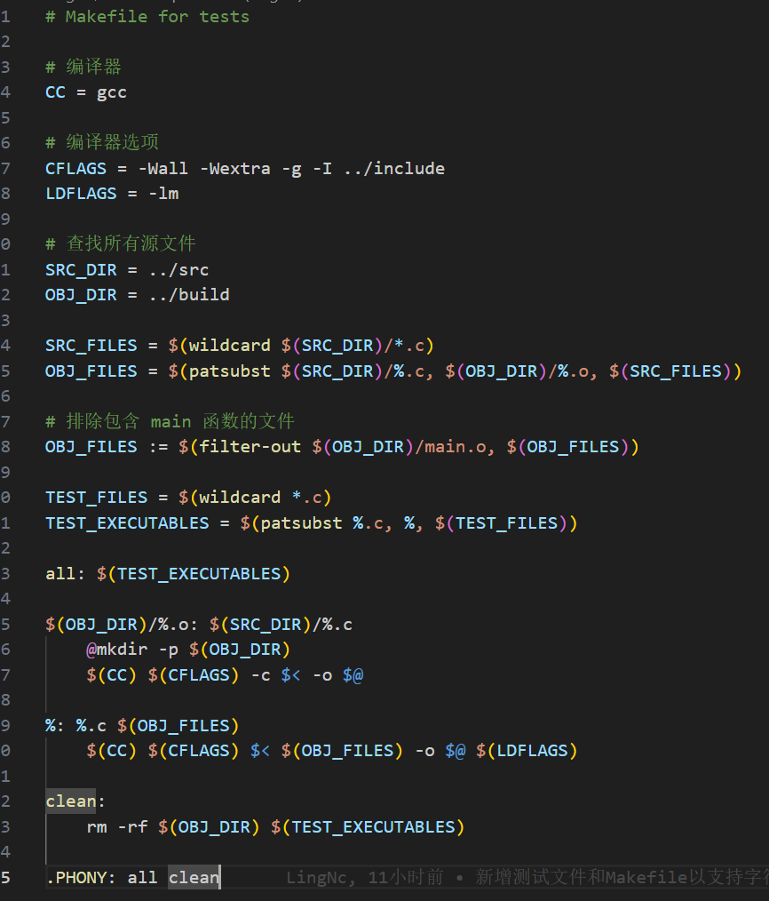


---

## **总结**

通过以上项目安排，可以实现一个功能完善、结构清晰的图书馆管理系统。需要造的轮子包括vector、List、string、pair、Hash、Trie。文件操作封装、字符串处理、时间处理、双套 UI 界面（命令行 + ncursesw TUI）、错误处理、内存管理和测试框架。