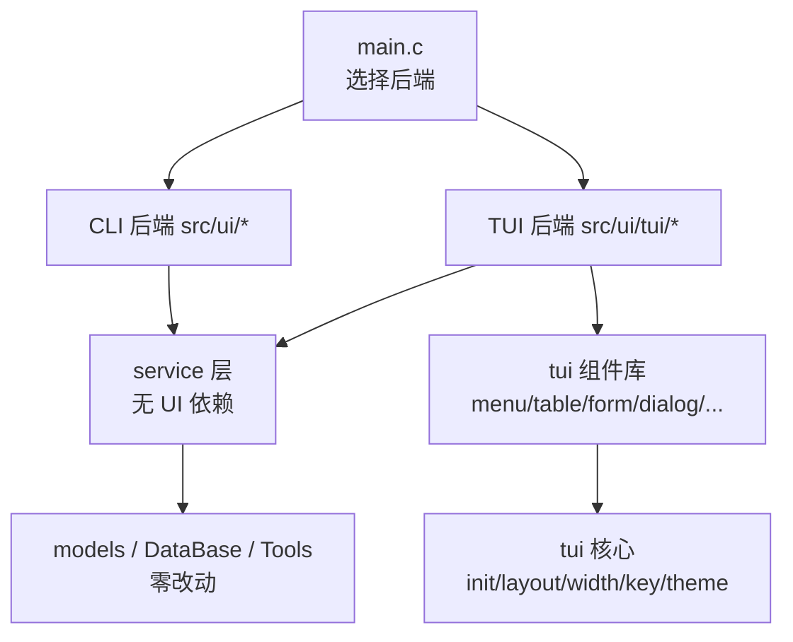
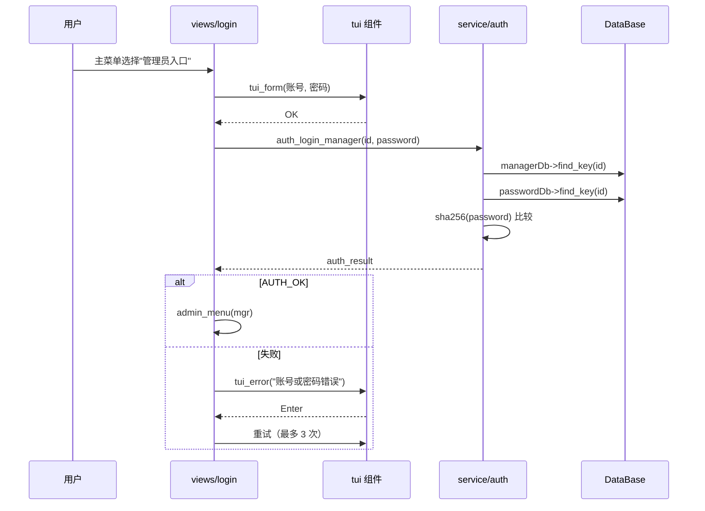

# 图书管理系统 TUI 实现方案（ncursesw）

> 文档对象：项目作者 + AI 编码助手
> 版本：v1（2026-10-30）
> 状态：**待评审 → 评审通过后按 §9 里程碑执行**

---

## 0. 这份文档怎么用

- 对**人**：说明"要做什么、为什么这么做、分几步做、每步怎么验收"。
- 对**AI**：作为实现的**唯一约束来源**。动手前先读 §2 的约束和 §12 的协作约定；每个里程碑只做该阶段范围内的事，不提前动后续模块。
- 进度跟踪：§9 的复选框是任务清单，完成一项勾一项，不要静默跳步。
- 变更记录：方案若有调整，改本文档并在 §13 追加记录，不要只在聊天里说。

---

## 1. 目标与非目标

### 1.1 目标

1. 用 **ncursesw**（宽字符版 ncurses）为项目增加一套完整的 TUI（终端用户界面），覆盖现有全部功能：
   - 主菜单、学生/管理员登录、密码验证
   - 管理员：图书/学生/管理员的新增、删除、修改、分页浏览
   - 学生：借书、还书、借阅信息查看
   - 批量导入、搜索、命令/帮助
2. **不破坏现有 CLI**：同一份代码可构建 CLI，也可构建 TUI；默认提供运行时开关。
3. 界面在中文环境下**对齐正确**（全角字符、左右边框不错位）。
4. 业务逻辑（模型 + 数据库 + 工具层）**零改动**（除非为解耦做纯机械提取）。
5. 代码可测试：终端无关的逻辑（业务、排版、键位映射）能被单元测试覆盖。

### 1.2 非目标（本期不做）

- 不做鼠标拖拽、窗口自由缩放（仅支持 resize 后重绘）。
- 不做多语言（i18n）切换，界面文案仍为中文。
- 不替换数据存储层（`.idx` 文件 + 索引库保持不变）。
- 不追求动画效果；只做必要的 toast/进度反馈。

---

## 2. 现状分析与关键约束

### 2.1 现有分层

```
main.c
  └── ui/            printf + getch 的"逐屏阻塞"式界面
        ├── main_menu.c       主菜单 / 登录
        ├── command.c         命令模式（Trie 自动补全）
        ├── components/       menu / page / list / func / passwd
        ├── admin/            管理员各功能页
        └── student/          学生各功能页
  └── models/        Book / Student / Manager（纯数据 + 操作）
  └── DataBase/      文件数据库 + 索引
  └── Tools/         Vector / String / Hash / Trie ...
  └── function.c     批量导入、初始化 root 等"业务杂项"
```

规模约 6000 行，`printf / getch / clear_screen` 调用点约 270 处，其中**非 UI 层只有 2 处**：

| 位置 | 调用 | 影响 |
|---|---|---|
| `src/function.c:25` | `clear_screen()` | 批量导入时刷新进度 |
| `src/function.c:160` | `getch()` | 等待按键 |

这是一个好消息：**UI 逻辑基本集中在 `src/ui/` 内**，业务层与 UI 的耦合面很小。

### 2.2 现有 UI 的交互模型（TUI 必须兼容）

1. **阻塞式逐屏**：`menu()` 自己循环画屏、按键、执行回调；`page()` 同理。没有全局事件循环。
2. **回调表**：`menu(n_choices, choices, funcs, args)`，约定：
   - `funcs[0]` = 屏前信息（preInfo）
   - `funcs[1..n_choices-1]` = 选项动作
   - `funcs[n_choices]` = 屏后信息（postInfo）
   - `args` 与 `funcs` 下标对齐
   - 注意现有实现里 `choice = highlight + 1`，而循环 `for i = 1..n_choices-1`，即**第 0 个选项对应 `funcs[1]`**（隐式偏移），TUI 侧必须显式建模，别再复制这个隐式约定。
3. **`page()` 的参数非常隐式**：`args[0]=pageSize, args[1]=lineSize, args[2]=page, args[3]=totalPages`，还从 `arg[3..5]` 里读"是否只显示已借书籍 / borrowDb / student"。TUI 不复用这套参数布局，改为显式结构体（见 §5.5）。
4. **按键已做映射**：`getch()` 把方向键转成 `w/a/s/d`，`q` 退出，`\n` 确认，`/` 命令模式，数字直接跳转。

### 2.3 三个必须先解决的坑

#### 坑 1：与 ncurses 的符号/宏冲突（**阻塞级**）

ncursesw 导出了 `getch` 和 `refresh`：

```
$ nm -D libncursesw.so.6 | grep -wE 'getch|refresh'
T getch
T refresh
```

而项目里有：

```c
char getch();                                                  // include/ui/components/func.h
void refresh(char *input, int *input_index, const char *new_content);  // 同名、不同签名
```

后果：

- **编译期**：任何同时 `#include <curses.h>` 和 `ui/components/func.h` 的 TU 都会炸，因为 curses 把 `getch`/`refresh` 定义成宏（`wgetch(stdscr)` / `wrefresh(stdscr)`）。
- **链接期**：可执行文件的 `getch` 会**覆盖**库里的 `getch`，属于未定义行为，随时可能被 ncurses 内部调用踩到。

**对策（必须做，M0 第一步）**：重命名项目侧函数

| 旧名 | 新名 | 说明 |
|---|---|---|
| `getch()` | `cli_getch()` | 全仓库机械替换 |
| `refresh(s,i,c)` | `cli_refresh_line(s,i,c)` | 仅 `func.c` / `command.c` 使用 |
| `clear_screen()` | `cli_clear_screen()` | 无冲突，但为对称与可读性一起改 |

> 备选方案（不推荐）：`#define NCURSES_NOMACROS` 或 `#undef getch`。只能解决编译期，解决不了符号覆盖。

#### 坑 2：中文宽度

- 项目字符串是 UTF-8 `char*`，菜单项是 `wchar_t*`，两种都要处理。
- 中文是全角（宽度 2），用 `strlen` 算列宽必然错位。
- 统一规则：所有绘制走 **`wchar_t` + `wcwidth()`**，宽度计算封装在 `ui_width` 模块，禁止在视图里手写 `strlen` 对齐。

#### 坑 3：业务函数里混着 `printf` / `perror`

例如 `load_books_from_file()` 用 `clock_times()` 打印进度、`edit_book()` 直接打印、`add_manager()` 直接打印。这些函数被 TUI 复用时会把文字打到 curses 屏幕外，导致花屏。

**对策**：抽一层薄 **service**（§5.6），服务函数只做数据操作并返回结构化结果，不打印；进度通过回调上报。CLI 视图负责把结果 `printf` 出来。

---

## 3. 技术选型

| 维度 | 选择 | 理由 |
|---|---|---|
| 库 | **ncursesw**（`-lncursesw -ltinfo`） | 需求指定；已确认本机可用（`pkg-config --libs ncursesw` 正常） |
| 字符 | **宽字符 API**：`wget_wch` / `waddnwstr` / `wcwidth` | 中文对齐的唯一可靠做法 |
| 光标/输入 | `cbreak + noecho + keypad` | 逐键响应，兼容方向键 |
| 布局 | 自绘边框窗口（`newwin` + `box`），非 form/menu 扩展库 | 现有 UI 结构简单，用扩展库反而难控中文与自定义布局 |
| 并发 | 无 | 保持单线程，避免引入线程复杂度 |
| 后端切换 | **运行时参数** `--tui`，CLI/TUI 共存于同一二进制 | 改动最小、可对比调试、出问题可退回 |

> 为什么不用 `ncurses` 的 `menu`/`form` 扩展库：它们对宽字符列宽处理不透明、样式定制受限，且会引入额外状态管理。自己封装 4 个组件（menu/table/form/dialog）成本更低。

---

## 4. 总体架构

### 4.1 分层



关键原则：

- **service 层不知道 UI 存在**：不 `printf`、不读键盘、不 `clear_screen`。
- **TUI 组件库不知道业务存在**：只接收纯数据与回调。
- **视图层（views）负责组装**：service + 组件，是唯一同时认识两边的地方。

### 4.2 双后端共存（推荐，不搞编译期二选一）

```
./main          → CLI（现有行为不变）
./main --tui    → TUI
```

- TUI 所有符号统一加 `tui_` / `ui_` 前缀，与 CLI 不冲突。
- Makefile 用 `UI=both|cli|tui` 控制是否编译 TUI 目录（无 ncurses 的机器可用 `make UI=cli`）。
- `main.c` 只加一个分支，不动现有 `main_menu()` 调用路径。

### 4.3 交互模型：**阻塞式组件**（与现有代码同构）

不要一上来搞"状态机 + 全局事件循环 + 路由栈"，那会让所有现有视图重写。第一期沿用现有风格：

```c
void admin_book_menu(void *arg) {
    for (;;) {
        int choice = tui_menu(&(tui_menu_spec){
            .title = "图书管理",
            .items = ...,
            .count = 4,
            .pre_info = draw_book_header,   /* 可选 */
        });
        if (choice < 0 || choice == 3) break;
        switch (choice) { ... }             /* 顺序代码，和 CLI 一致 */
    }
}
```

- 每个组件内部：`绘制 → 读键 → 更新状态 → 重绘`，直到 Enter/q 返回。
- 返回值约定：`>= 0` 选中下标；`-1` 取消/返回。
- **好处**：视图代码几乎可以照抄现有 `menu()` 调用处的结构，认知负担最低。
- **后续演进**（非本期）：如果需要全局搜索、跨页跳转、异步加载，再在组件之上加 `ui_push_view/ui_pop_view` 的栈式路由；组件 API 不变。

### 4.4 新增目录结构（已实现，含与设计的差异）

```
include/ui/tui/
├── tui.h              # 生命周期 + 主入口 tui_run()
├── demo.h             # M1 组件演示（M2 起替换为真实视图）
├── key.h              # 键抽象（与 ncurses 解耦）
├── width.h            # UTF-8/宽字符 宽度、截断、转换（不依赖 ncurses）
├── theme.h            # 颜色/属性
├── window.h           # 窗口/边框/标题/状态栏/布局
└── components/
    ├── menu.h
    ├── table.h
    ├── form.h
    └── dialog.h

src/ui/tui/
├── tui.c  key.c  width.c  theme.c  window.c  demo.c
└── components/{menu,table,form,dialog}.c
```

与初稿的差异（实现时发现更合理，已按此执行）：

| 初稿 | 实际 | 原因 |
|---|---|---|
| 独立的 `input.h` | 合并进 `components/form.c` | 目前只有表单需要单行编辑；等命令面板需要时再抽 |
| 独立的 `statusbar.h` | 合并进 `window.c`（状态栏是帧的一部分） | 状态栏与帧同一布局语义，分开反而要传更多参数 |
| 独立的 `toast.h` | 合并进 `components/dialog.c` | toast 是对话框的非阻塞变体 |
| `width.c` 内含绘制函数 | `width.c` 纯逻辑，绘制在 `window.c` | 让 `width.c` 能被单元测试单独链接，不引入 ncurses |

> 现有 `include/ui/**`、`src/ui/**`（非 tui 子目录）保持原位，**不做目录搬迁**，避免一次性的巨大 diff。

---

## 5. 核心 API 草案

> 这些是"契约"，实现可微调，但**签名变更需同步本文档**。

### 5.1 生命周期

```c
/* include/ui/tui/tui.h */
#ifndef TUI_H
#define TUI_H

#include <stdbool.h>

/* 返回进程退出码；内部完成 init/shutdown、异常恢复 */
int  tui_run(void);

/* 供内部与测试使用 */
bool tui_init(void);     /* setlocale/ initscr / cbreak / noecho / keypad / color */
void tui_shutdown(void); /* endwin()，可重复调用 */

#endif
```

`tui_init()` 必须做的顺序（**顺序不能错**）：

```c
setlocale(LC_ALL, "");          /* 已在 main() 调用，保持即可，必须在 initscr 前 */
initscr();
cbreak();
noecho();
keypad(stdscr, TRUE);
set_escdelay(25);               /* ncurses >= 6.1；旧版本用 ESCDELAY 环境变量 */
curs_set(0);
if (has_colors()) { start_color(); use_default_colors(); }
```

`tui_shutdown()` 通过 `atexit()` + `SIGINT/SIGTERM/SIGSEGV` 处理器兜底，**保证终端不残留**：

```c
static void on_fatal_signal(int sig) {
    tui_shutdown();
    signal(sig, SIG_DFL);
    raise(sig);
}
```

### 5.2 键抽象（解耦 ncurses，便于单元测试）

```c
/* include/ui/tui/key.h */
typedef enum {
    TUI_KEY_NONE = 0,
    TUI_KEY_UP, TUI_KEY_DOWN, TUI_KEY_LEFT, TUI_KEY_RIGHT,
    TUI_KEY_ENTER, TUI_KEY_ESC, TUI_KEY_TAB, TUI_KEY_BACKSPACE, TUI_KEY_DELETE,
    TUI_KEY_PGUP, TUI_KEY_PGDN, TUI_KEY_HOME, TUI_KEY_END, TUI_KEY_RESIZE,
    TUI_KEY_F1,
    TUI_KEY_CHAR      /* 可打印字符，值在 ch 中 */
} tui_key_type;

typedef struct { tui_key_type type; wchar_t ch; } tui_key;

tui_key tui_read_key(void);         /* 唯一接触 wget_wch 的地方 */
```

映射规则（与现有 CLI 保持一致，另加 TUI 习惯键）：

| 语义 | 现有 CLI | TUI 接受 |
|---|---|---|
| 上/下移 | `w` / `s`、方向键 | `k`/`j`、`w`/`s`、↑/↓ |
| 左/右翻页 | `a`/`d` | `h`/`l`、PgUp/PgDn、←/→ |
| 确认 | `Enter` | Enter |
| 返回/取消 | `q` | `q`、Esc |
| 命令模式 | `/` | `/` |
| 数字直选 | `1`..`9` | `1`..`9` |
| 帮助 | `/help` | `F1`、`?` |
| 搜索 | `/search` | `/` 打开命令面板 |
| 表单切换字段 | 无 | Tab / Shift-Tab（`KEY_BTAB`） |

### 5.3 宽度与文本工具

```c
/* include/ui/tui/width.h */
#include <stddef.h>
#include <wchar.h>

wchar_t *ui_wcs_from_utf8(const char *s);   /* 调用方 free；NULL 安全 */
char    *ui_utf8_from_wcs(const wchar_t *s);
size_t   ui_wcswidth(const wchar_t *s);      /* wcswidth，异常按 1 列处理 */
void     ui_draw_clipped(WINDOW *w, int y, int x, int max_cols, const wchar_t *s);
void     ui_draw_right(WINDOW *w, int y, int x_end, const wchar_t *s);
```

`ui_draw_clipped` 必须**按列宽而不是字符数**截断，遇全角不劈半：

```c
void ui_draw_clipped(WINDOW *w, int y, int x, int max_cols, const wchar_t *s) {
    int used = 0;
    for (const wchar_t *p = s; *p; ++p) {
        int cw = wcwidth(*p);
        if (cw < 0) cw = 1;
        if (used + cw > max_cols) break;
        mvwaddnwstr(w, y, x + used, p, 1);
        used += cw;
    }
}
```

### 5.4 窗口/布局

```c
/* include/ui/tui/window.h */
typedef struct {
    int y, x, h, w;      /* 相对父窗口 */
} ui_rect;

WINDOW *ui_root(void);                         /* stdscr 包装 */
void     ui_frame_begin(const char *title);    /* 画外框 + 标题 + 状态栏占位 */
void     ui_frame_end(void);                   /* wnoutrefresh + doupdate（原子刷新） */
ui_rect  ui_split_v(ui_rect parent, int top_h); /* 可选布局工具 */
```

刷新策略：组件内全部 `wnoutrefresh`，由 `ui_frame_end()` 统一 `doupdate()`，**避免闪烁**。

### 5.5 组件 API

#### 菜单

```c
/* include/ui/tui/components/menu.h */
typedef struct {
    const char *title;             /* 可为 NULL */
    const char *const *items;      /* UTF-8 文案数组 */
    int count;
    int initial;                   /* 初始高亮，一般 0 */
    void (*pre_info)(void *ctx, WINDOW *content, int *y);   /* 屏前信息，可选 */
    void (*post_info)(void *ctx, WINDOW *content, int *y);  /* 屏后信息，可选 */
    void *ctx;
} tui_menu_spec;

/* 返回选中下标；-1 表示用户取消（q/Esc） */
int tui_menu(const tui_menu_spec *spec);
```

#### 表格（分页）

```c
/* include/ui/tui/components/table.h */
typedef struct {
    const char *title;
    const char *const *headers;    /* 表头（UTF-8） */
    const int  *col_widths;        /* 每列显示宽度（列数） */
    size_t ncols;

    /* 数据源：分页回调，避免一次性加载全库 */
    size_t (*row_count)(void *ctx);
    void   (*row_text)(void *ctx, size_t row, size_t col, char *out, size_t cap);
    void  *ctx;

    size_t page_size;              /* 默认 10 */
} tui_table_spec;

/* 返回绝对行号；-1 取消 */
long tui_table(const tui_table_spec *spec);
```

行文本生成复用抽出的格式化函数（§5.6），而不是 `display_one_line` 里的 `printf`。

#### 表单

```c
/* include/ui/tui/components/form.h */
enum {
    TUI_FIELD_MASKED   = 1 << 0,   /* 密码：显示 * */
    TUI_FIELD_NUMERIC  = 1 << 1,   /* 只允许数字 */
    TUI_FIELD_READONLY = 1 << 2,
    TUI_FIELD_MULTILINE= 1 << 3,   /* 预留 */
};

typedef struct {
    const char *label;             /* UTF-8 */
    char       *buf;               /* 调用方提供，UTF-8，容量 cap */
    size_t      cap;
    unsigned    flags;
    /* 返回 NULL 表示通过；否则返回错误文案（静态字符串或自定义缓冲区） */
    const char *(*validate)(const char *value, char *err, size_t errcap);
} tui_field;

typedef enum { TUI_FORM_OK = 0, TUI_FORM_CANCEL, TUI_FORM_QUIT } tui_form_result;

/* 返回 OK 时所有 buf 已写入；CANCEL 时内容可能被修改，调用方自行忽略 */
tui_form_result tui_form(const char *title, tui_field *fields, size_t nfields);
```

#### 对话框 / 提示

```c
void tui_info(const char *fmt, ...);                 /* 阻塞，Enter 关闭 */
void tui_error(const char *fmt, ...);
bool tui_confirm(const char *fmt, ...);              /* y/n，默认 n */
void tui_toast(const char *fmt, ...);                /* 非阻塞，底部短暂显示 */
```

#### 状态栏

```c
void tui_statusbar(const char *hint);   /* 例："↑↓ 选择  Enter 确认  q 返回  / 命令" */
```

### 5.6 service 层（与 UI 解耦的关键）

```c
/* include/service/auth.h */
typedef enum {
    AUTH_OK = 0, AUTH_USER_NOT_FOUND, AUTH_BAD_PASSWORD, AUTH_NOT_CONFIGURED, AUTH_IO_ERROR
} auth_status;

typedef struct {
    auth_status status;
    manager     mgr;      /* 仅 AUTH_OK 有效 */
} auth_result;

auth_result auth_login_manager(size_t id, const char *password);
bool        auth_verify_password(size_t id, const char *password);
bool        auth_set_password(size_t id, const char *password);  /* 内部做 sha256 */

/* include/service/book.h */
typedef enum { OP_OK, OP_INVALID, OP_DUPLICATE, OP_NOT_FOUND, OP_IO_ERROR } op_status;

typedef struct {
    op_status status;
    char      message[128];
} op_result;

op_result book_add(book b);
op_result book_update(book old_item, book new_item);
op_result book_remove(size_t id);

/* 批量导入：进度通过回调，不直接 printf */
typedef void (*progress_fn)(const char *stage, size_t done, size_t total, void *ctx);
op_result book_import_file(const char *path, progress_fn cb, void *ctx);

/* include/service/format.h —— 供 CLI/TUI 共用的行格式化 */
void format_book_row(book b, char *out, size_t cap);       /* 含"已借出/可借/逾期"状态 */
void format_student_row(student s, char *out, size_t cap);
void format_manager_row(manager m, char *out, size_t cap);
```

CLI 侧的 `display_one_line` 改为调用 `format_*` 后 `printf`，行为保持一致；TUI 侧把同一输出塞进表格单元格（必要时按列再拆分，见 §6.2）。

> 迁移顺序：先加 service 并让 CLI 调用（保证 CLI 行为不变、`make test` 通过），再让 TUI 调用。

---

## 6. 组件实现细节

### 6.1 屏幕骨架

```
┌────────────────────────────────────────────────────────────┐
│ 图书管理系统 · 图书管理                    root@ID:1        │  ← 标题栏（反色）
├────────────────────────────────────────────────────────────┤
│                                                            │
│   当前账号: ID: 1, 姓名: root ...                          │  ← pre_info 区
│                                                            │
│  > 1. 查看图书列表                                         │  ← 内容区
│    2. 增加图书                                             │
│    3. 导入图书                                             │
│    4. 返回                                                 │
│                                                            │
├────────────────────────────────────────────────────────────┤
│ ↑↓/jk 选择  Enter 确认  q 返回  / 命令       共 128 本 第1页│  ← 状态栏
└────────────────────────────────────────────────────────────┘
```

- 最小尺寸 80×24；小于该尺寸时显示"终端过小"提示并等待 resize。
- 内容区过高/过窄时统一裁剪，不滚屏。

### 6.2 表格与分页

- 每页行数默认 10，可通过命令 `/set N` 修改（复用 `execute()` 的命令解析，但改成"返回动作"而非直接打印）。
- 表头固定；数据行左右对齐按列宽（`ui_wcswidth`），超宽省略号 `…`（全角宽度 2）。
- 书籍状态列单独成列，格式化逻辑从 `display_one_line` 抽出。
- 分页读取：调用 `db->get(db, page*size, size)` 得到当前页 `vector`，绘制完立即 `free`；**不要持有跨页指针**（现有 `page()` 也有此约定）。
- 行高亮用 `A_REVERSE`；选中后回车触发动作。

### 6.3 表单输入（中文/UTF-8/密码）

- 缓冲区仍是 UTF-8 `char[]`，但**按 Unicode 码点编辑**：插入/删除前用 `mbrtowc`/`wctomb` 定位边界。
- 退格删除一个完整字符（中文 3 字节一次删掉），不允许删出半个字符。
- 密码字段：保存真实值，渲染时按显示宽度输出 `*`（每个码点一个 `*`）。
- 数字字段：过滤非数字；`ID`、`页大小` 用它。
- 校验：字段级 `validate`，失败时在字段下方红色提示，不关闭表单。
- 输入法：ncursesw 收到的是已上屏的宽字符，IME 候选框由终端负责，**不需要额外处理**；但要注意 `wget_wch` 返回 `KEY_CODE_YES` 时是功能键，不能当字符插入。

### 6.4 登录流程（时序）



学生登录保持现有逻辑：`id = find_index(stoid, 学号)` 后再查 `studentDb`。

### 6.5 颜色主题

```c
enum {
    TUI_PAIR_NORMAL = 1,
    TUI_PAIR_TITLE,      /* 标题栏：黑底青字 */
    TUI_PAIR_HIGHLIGHT,  /* 选中行：反色/青底 */
    TUI_PAIR_ERROR,      /* 红 */
    TUI_PAIR_HINT,       /* 灰 */
    TUI_PAIR_STATUS_OK,  /* 绿 */
};
```

- `has_colors()` 为假时全部退化为 `A_REVERSE`/`A_BOLD`，不得依赖颜色传达信息。
- 用 `use_default_colors()` + `-1` 背景，适配任意终端主题。

### 6.6 中文/宽字符注意事项汇总

| 问题 | 做法 |
|---|---|
| 中英混排对齐 | 一律 `wcwidth` 计算，禁止 `strlen` |
| 宽字符截断 | 按列宽截断，全角不能切一半 |
| 输入退格 | 按码点删除 |
| `setlocale` | 必须在 `initscr` 之前 |
| `wget_wch` 返回值 | `OK` = 普通字符；`KEY_CODE_YES` = 功能键；`ERR` = 忽略 |
| 终端不支持中文 | 启动时检测 `MB_CUR_MAX > 1`，否则提示并回退 CLI |

---

## 7. 与现有代码的对接清单

### 7.1 必须修改（M0）

| 文件 | 改动 |
|---|---|
| `include/ui/components/func.h`、`src/ui/components/func.c` | `getch`→`cli_getch`，`refresh`→`cli_refresh_line`，`clear_screen`→`cli_clear_screen` |
| 全仓库 `src/ui/**`、`src/function.c` | 同步改名（机械替换） |
| `Makefile` | 增加 `UI` 变量、ncursesw 检测与链接、TUI 源文件过滤 |
| `src/main.c` | 增加 `--tui` 分支（`#ifdef HAVE_TUI`） |

### 7.2 新增文件

见 §4.4。建议顺序：核心（tui/key/width/window/theme）→ 组件（menu/table/form/dialog/statusbar/toast）→ 视图。

### 7.3 复用（不改）

- `src/models/**`、`src/DataBase/**`、`src/Tools/**`、`include/**` 下的数据层头文件。
- `str_time()`、`load_book/load_student/load_manager` 等构造函数。
- `find_index`（`Index`）、`sha256`（`Hash`）。

### 7.4 需要"拆分"的现有函数

| 现有函数 | 问题 | 拆分方式 |
|---|---|---|
| `verify_password`（main_menu.c） | 内含 `printf` + `get_password` | → `auth_verify_password` + 视图循环 |
| `login` | UI 与业务混杂 | → `auth_login_*` + `views/login.c` |
| `add_book_manual`/`edit_book`/`delete_book` | 直接 `printf`/`getaline` | → `book_add/update/remove` + 表单视图 |
| `add_manager`/`edit_manager`/`delete_manager` | 同上 | → `manager_*` + 表单视图 |
| `load_books_from_file`/`load_students_from_file` | `clock_times` 打印进度 | → `*_import_file(path, progress_cb)` |
| `page()` / `menu()` | 隐式参数布局 | TUI 用显式结构体，不复用 |

---

## 8. 构建变更

```make
# ---- UI 后端：both(默认) | cli | tui ----
UI ?= both

NCURSES_CFLAGS := $(shell pkg-config --cflags ncursesw 2>/dev/null)
NCURSES_LIBS   := $(shell pkg-config --libs ncursesw 2>/dev/null)

ALL_SRC_FILES := $(shell find src -type f -name '*.c' | sort)

ifeq ($(UI),cli)
SRC_FILES := $(filter-out src/ui/tui/%,$(ALL_SRC_FILES))
else
SRC_FILES := $(ALL_SRC_FILES)
CPPFLAGS  += $(NCURSES_CFLAGS) -DHAVE_TUI=1
LDLIBS    += $(NCURSES_LIBS)
endif
```

测试不受影响：现有 `TEST_SUPPORT_OBJECTS` 已过滤 `$(BUILD_DIR)/src/ui/%`，TUI 位于 `src/ui/tui/` 下同样被排除，因此**单元测试不链接 ncurses**。

唯一例外是 `test/test_tui_width.c`：它只测 `width.c` 的纯逻辑，因此单独一条规则只链接 `width.o`：

```make
TUI_WIDTH_OBJECT := $(BUILD_DIR)/src/ui/tui/width.o
TUI_WIDTH_TEST   := $(BUILD_DIR)/test_tui_width
UNIT_TEST_TARGETS += $(TUI_WIDTH_TEST)

$(TUI_WIDTH_TEST): test/test_tui_width.c $(TUI_WIDTH_OBJECT)
	@mkdir -p $(@D)
	$(CC) $(CPPFLAGS) $(CFLAGS) $^ $(LDFLAGS) -o $@

.PHONY: test-tui
test-tui: $(TUI_WIDTH_TEST)
	./$(TUI_WIDTH_TEST)
```

常用命令：

| 命令 | 作用 |
|---|---|
| `make` | 构建 CLI + TUI（默认 both） |
| `make UI=cli` | 只构建 CLI，完全不依赖 ncursesw |
| `make test-tui` | 只跑 TUI 纯逻辑测试（不受已知 #1 影响） |
| `make test` | 全部测试（当前因已知问题 #1 仍会失败） |
| `./main` / `./main --tui` | 分别进入 CLI / TUI |

`main.c` 变更：

```c
#include <string.h>
#ifdef HAVE_TUI
#include "ui/tui/tui.h"
#endif

int main(int argc, char **argv) {
    /* ...现有初始化... */

#ifdef HAVE_TUI
    if (argc > 1 && strcmp(argv[1], "--tui") == 0) {
        int rc = tui_run();
        if (rc != 0) {
            fprintf(stderr, "TUI 启动失败，回退到 CLI\n");
        } else {
            return 0;
        }
    }
#endif
    main_menu();
    return 0;
}
```

---

## 9. 分阶段实施计划

> 每个里程碑结束都必须：`make` 通过、`make test` 通过、CLI 手动冒烟通过。M2 起增加 TUI 冒烟。

### M0 构建与解耦地基（预计 0.5 天）

- [x] 重命名 `getch` / `refresh` / `clear_screen` → `cli_getch` / `cli_refresh_line` / `cli_clear_screen`（全仓库，31 + 25 + 5 处）
- [x] Makefile：`UI` 变量、ncursesw 检测、TUI 目录过滤
- [x] 新增 `src/ui/tui/tui.c`：`tui_init/shutdown` + 演示屏（含 atexit / 信号兜底）
- [x] 新增 `include/ui/tui/tui.h`
- [x] `main.c` 增加 `--tui` 分支（失败回退 CLI）
- [x] **验收**：`make`、`make UI=cli` 均通过；`nm main` 不再导出 `getch`/`refresh`；演示屏与退出行为（交互待作者在真实终端确认）
- [ ] 待确认：`./main --tui` 在真实终端下的显示与 `q` 退出（自动化环境无 tty）

### M1 核心库 + 四个组件（预计 1.5 天）——已完成

- [x] `width.c`：UTF-8 转换、`wcswidth`、按列宽截断（附单元测试 `make test-tui`）
- [x] `key.c`：`tui_read_key`，方向键 / Backspace / Tab / Resize / F1 / EOF
- [x] `theme.c`：6 组颜色，无颜色时自动降级为 `A_REVERSE` / `A_BOLD`
- [x] `window.c`：外框、标题栏、状态栏、原子刷新（`wnoutrefresh` + `doupdate`）、终端过小提示
- [x] `menu.c`：高亮整行、pre/post info、数字直选
- [x] `form.c`：多字段、Tab/方向键切换、密码掩码、数字过滤、字段级校验、光标定位
- [x] `table.c`：表头、分隔线、分页、整行高亮、`on_enter` 回调
- [x] `dialog.c`：info / error / confirm / toast，按列宽自动换行
- [x] `demo.c`：`./main --tui` 进入的组件演示（宽度自检 / 菜单 / 表格 / 表单 / 对话框）
- [x] **验收**：tmux 伪终端逐页截图 + Python 计算显示列宽，**每行宽度完全一致（115/115）**，中文框线不错位；`make test-tui` 通过；`make UI=cli` 仍可构建

### M2 service 层抽取 + 主菜单/登录（预计 1 天）——已完成

- [x] `service/auth.c`：管理员结构化认证、学生学号索引查询；无终端 I/O
- [x] `service/format.c`：Book / Student / Manager 行格式化；CLI 列表复用
- [x] `views/main_menu.c`、`views/login.c`
- [x] `views/admin_menu.c`、`views/student_menu.c`：登录后角色控制台及用户信息
- [x] CLI 登录与列表显示改为调用 service（行为不变）
- [x] TUI 主入口从组件演示切换为真实主菜单；组件演示保留为主菜单第 3 项
- [x] **验收**：tmux 伪终端验证管理员错误密码提示、root/admin 成功登录、学生不存在提示、角色控制台与返回路径；`make`、`make test-tui`、`make UI=cli` 均通过

> M2 只负责认证与角色入口。角色菜单中 CRUD / 借还项明确显示“功能迁移中”，
> 不调用旧 `printf` UI；管理员功能在 M3 接入，学生借还在 M4 接入。

### M3 管理员功能（预计 2 天）

- [ ] `service/book.c`、`service/student.c`、`service/manager.c`
- [ ] 图书：列表/新增/修改/删除/批量导入（带进度条）
- [ ] 学生：列表/新增/修改/删除/批量导入
- [ ] 管理员：列表/新增/修改/删除/修改自己的密码（权限校验逻辑保持不变）
- [ ] **验收**：所有 CRUD 在 TUI 与 CLI 下结果一致（对照 `db/` 文件内容）

### M4 学生功能（预计 1 天）

- [ ] `service/borrow.c`
- [ ] 借书（书籍分页选择 + 借阅记录写入 `btos`/`borrow_records`）
- [ ] 还书（已借列表 + 逾期提示）
- [ ] 借阅信息查看
- [ ] **验收**：借/还流程与 CLI 一致，逾期天数显示正确

### M5 命令面板与搜索（预计 0.5 天）

- [ ] 复用 `Tools/Trie` 做 `/` 命令面板（`set/help/search/page`）
- [ ] 搜索结果在表格中展示
- [ ] **验收**：Tab 补全、命令执行不破坏界面

### M6 打磨与文档（预计 0.5 天）

- [ ] 颜色主题、错误提示统一、状态栏文案
- [ ] 终端过小提示、无颜色降级、`MB_CUR_MAX==1` 回退
- [ ] README 增加 TUI 使用说明与截图（可选）
- [ ] 本文档补充"实现差异记录"
- [ ] **验收**：`make UI=cli` 与 `make` 均通过；`./main --tui` 全流程可玩

### 时间总计

约 **7 人日**（不含评审与返工）。可以按里程碑分批合入，每个里程碑都是可运行状态。

---

## 10. 测试与验收

### 10.1 自动化

| 层 | 方式 |
|---|---|
| `width.c` | `test/test_tui_width.c`：中英混排宽度、截断、UTF-8 往返 |
| `key.c` 映射 | 把 `tui_read_key` 拆成"原始码 → `tui_key`"的纯函数，直接测 |
| service 层 | `test/test_service.c`：用临时目录建库，覆盖增删改查/登录失败/重复 ID |
| 既有测试 | `make test` 必须保持全绿 |

> 注意：ncurses 只能有一个进程实例操作终端，**不要**在单元测试里 `initscr`。所有可测逻辑必须与 ncurses 解耦。

### 10.2 手动冒烟清单（每个里程碑跑一遍）

- [ ] 主菜单 → 学生入口 → 返回 → 管理员入口 → 退出
- [ ] 错误密码 3 次后返回
- [ ] 图书列表翻页、数字跳转、Enter 查看
- [ ] 新增图书（含空值/重复 ISBN 校验）
- [ ] 批量导入 `Book.txt`，进度显示，完成后列表数量正确
- [ ] 修改/删除图书（删除需 `tui_confirm`）
- [ ] 借书 → 学生借阅列表出现 → 还书 → 状态恢复"可借"
- [ ] `Ctrl+C` / `SIGTERM` 退出后终端正常
- [ ] 终端 40×12 时提示过小；恢复大小后自动重绘
- [ ] 无颜色的 `TERM=dumb`/`mono` 终端可操作

### 10.3 CLI 回归

`./main` 全流程走一遍关键路径（登录、增删改查、借还），确认重命名与 service 抽取没有改变行为。

---

## 11. 风险与应对

| 风险 | 等级 | 应对 |
|---|---|---|
| `getch`/`refresh` 符号冲突导致诡异崩溃 | 高 | M0 必须改名；CI 中 `nm main \| grep getch` 校验仅来自 ncurses |
| 中文错位 | 高 | 统一 `wcwidth` 绘制；禁止 `strlen` 对齐；M1 专项验收 |
| 业务函数内 `printf` 打穿 curses | 高 | service 抽取；TUI 路径禁止调用任何带 `printf` 的旧视图函数 |
| 参数隐式（`page()` 的 `void *args[]`）抄错 | 中 | TUI 一律显式结构体，不复用旧参数布局 |
| 终端崩溃后残留乱码 | 中 | `atexit` + 信号兜底；`curs_set(1)` 恢复 |
| 大库一次性加载卡顿 | 中 | 表格分页按页取数，不缓存全库 |
| ncurses 版本差异（`set_escdelay`） | 低 | 版本条件编译 / `ESCDELAY` 环境变量 |
| 双后端代码漂移 | 中 | service 唯一数据入口；每个里程碑对照 CLI 结果 |
| 数据层既有 bug 被误判为 TUI 问题 | 中 | 每个里程碑先跑 CLI 对照组；异常先复现再定位，见 §12.1.1 |

---

## 12. 协作约定（给 AI 的硬性规则）

1. **不碰数据层**：`src/models`、`src/DataBase`、`src/Tools` 不做"顺手重构"；确需修改先写进本文档。
1.1 **数据层可能存在既有 bug（已知且被作者确认）**。测试过程中一旦在 `src/models`、`src/DataBase`、`src/Tools`、`src/function.c` 中发现异常行为：
   - **立即停止当前改动**，不自行修复、不"临时绕过"；
   - 输出一份最小复现（输入、实际输出、期望输出、涉及文件行号）通知作者；
   - 得到作者确认后再决定：修复 / 在文档中记录为已知问题 / 由作者本人处理。
   - TUI 侧不得为了让界面"看起来正常"而补丁式掩盖数据层问题。
2. **TUI 代码不调用** `printf`/`scanf`/`getchar`/`clear_screen`；统一走 `ui_*` 与 `tui_*`。
3. **不用 `strlen` 计算显示列宽**；中文对齐只用 `width.c`。
4. **不改 CLI 行为**：重命名/抽 service 后必须跑 CLI 冒烟；`make test` 必须绿。
5. **每个 PR/提交只覆盖一个里程碑的一项**，标题写 `tui(M1): ...`。
6. **新增用户可见文案放视图层**，组件库内不写死中文。
7. **所有 ncurses 调用集中**在 `src/ui/tui/`，其他目录不得 `#include <curses.h>`。
8. 遇到与本文档冲突的现状，**先改文档再改代码**。
9. **表单上下文里可打印字符永远是文本**：`j/k/h/l/w/s` 只有作为方向键含义时才导航。
   （M1 实测 bug：密码框输入 `pass123` 时 `s` 被当成"下一字段"，导致丢字符。）
10. **非交互终端必须拒绝启动**：`tui_init()` 里用 `isatty()` 拦截，
    否则 `wget_wch` 永远返回 `ERR`，组件会陷入忙等并刷屏。`TUI_KEY_EOF` 兜底处理为退出。

---

## 13. 变更记录

| 日期 | 版本 | 内容 | 作者 |
|---|---|---|---|
| 2026-10-30 | v1 | 初稿：架构、API、里程碑 | AI |
| 2026-10-30 | v1.1 | 新增 §12.1.1「数据层 bug 处置规则」（作者要求：发现即报告，不自行修复）；风险表补充一条 | AI |
| 2026-10-30 | v1.2 | M0 完成：签名改名、Makefile `UI` 开关、TUI 骨架；记录 §14 已知问题 #1 | AI |
| 2026-10-30 | v1.3 | M1 完成：`width/key/theme/window` + 4 个组件 + 组件演示；修正表单按键语义、新增非 tty 拦截；#1 经作者确认暂不修复 | AI |
| 2026-10-30 | v1.4 | M2 完成：认证与格式化 service、真实主菜单、管理员/学生登录与角色控制台；CLI 复用 service | AI |

---

## 14. 已知问题（数据层，待作者确认）

> 按 §12.1.1，此处只记录与复现，**未经作者确认不修改**。

### #1 `make test` 中 `test_vector` 段错误

- **状态**：**已由作者决定暂不修复**（2026-10-30），标记为已知失败；后续遇到相关问题再处理。
- **影响**：`make test` 会在此处失败并终止后续用例；TUI 纯逻辑测试请用 `make test-tui`。
- **发现时机**：M0 验收跑 `make test`
- **复现**

  ```sh
  make test            # 或直接 ./build/test_test_vector
  ```

  ```text
  All string tests passed!
  Segmentation fault (core dumped)
  ```

- **回溯**

  ```text
  Program received signal SIGSEGV, Segmentation fault.
  0x00007ffff7f11e47 in ?? () from /lib/x86_64-linux-gnu/libc.so.6
  #0  ... libc.so.6
  #1  test_string_vector () at test/test_vector.c:70
  #2  main () at test/test_vector.c:80
  ```

- **疑似根因**：`new_vector("char*")` 在 `src/Tools/Vector.c` 的 `_init_all()` 中落到最后的 `else` 分支；
  其中只识别 `int / float / double / size_t / char`，`"char*"` 不匹配 → `result = 0` →
  `_itemSize = 0` → `malloc(0)`。随后 `push_back` 6 个元素越界写入，`at()` 返回非法指针，
  `strcmp` 崩溃（`test/test_vector.c:70`）。
  同时该分支未设置 `_dcmp_item`，对 `"char*"` 而言比较函数为空。
- **为什么不是 TUI 改动引入**：本次改动仅涉及 `src/ui/**`、`src/main.c`、`Makefile`；
  `src/Tools/`、`src/models/`、`src/DataBase/` 在工作区中无任何修改（`git status` 可核对）。
- **可选处置**（等作者决定）

  1. 修 `Vector.c`：为 `"char*"` 补 `_itemSize = sizeof(char*)` 与对应比较函数；
  2. 认为 `"char*"` 已废弃（现推荐 `"String"`），把 `test_vector.c` 的该用例改写/删除；
  3. 暂不处理，`make test` 中跳过该用例，并在此处标记为已知失败。

---

## 附：M0 最小可运行示例（用于验证环境）
```c
/* src/ui/tui/tui.c —— M0 版本，仅用于验证 ncursesw 可用 */
#include <locale.h>
#include <curses.h>
#include "ui/tui/tui.h"

bool tui_init(void) {
    setlocale(LC_ALL, "");
    if (!initscr()) return false;
    cbreak();
    noecho();
    keypad(stdscr, TRUE);
    curs_set(0);
    if (has_colors()) { start_color(); use_default_colors(); }
    return true;
}

void tui_shutdown(void) {
    if (!isendwin()) endwin();
}

int tui_run(void) {
    if (!tui_init()) return 1;
    mvaddwstr(1, 2, L"图书管理系统 · TUI 演示");
    mvaddwstr(3, 2, L"中文对齐测试：图书 128 本 / 学生 42 人");
    mvaddstr(5, 2, "Press q to quit.");
    refresh();
    while (1) {
        wint_t wc;
        int r = wget_wch(stdscr, &wc);
        if (r == OK && (wc == L'q' || wc == L'Q')) break;
        if (r == KEY_CODE_YES && wc == KEY_RESIZE) { clear(); refresh(); }
    }
    tui_shutdown();
    return 0;
}
```

验证命令：

```sh
pkg-config --cflags --libs ncursesw     # 应输出 -D_DEFAULT_SOURCE -D_XOPEN_SOURCE=600 -lncursesw -ltinfo
make                                    # CLI 正常构建
./main --tui                            # 演示屏，q 退出，终端无残留
make test                               # 既有测试全绿
```
